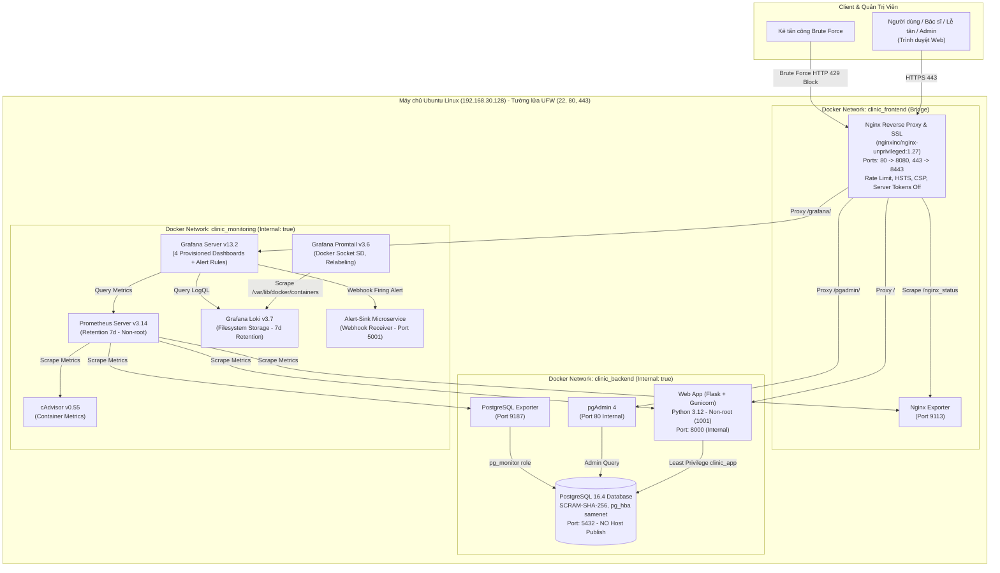

# DTC245200587-clinic-devops: Hệ Thống Quản Lý Phòng Khám / Bệnh Viện

## 1. Thông Tin Sinh Viên & Đề Tài
- **Họ và tên sinh viên**: Ma Thị Thanh Tú
- **Mã số sinh viên (MSSV)**: DTC245200587
- **Lớp**: CNTT K23C
- **Email học viện**: dtc245200587@ictu.edu.vn
- **Tài khoản GitHub**: DTC245200587
- **Tên Repository**: DTC245200587-clinic-devops
- **Học phần**: Triển khai và Quản trị Hệ thống Phần mềm
- **Đề tài số 8**: Hệ thống Quản lý Phòng khám / Bệnh viện

---

## 2. Giới Thiệu Đề Tài & Kiến Trúc Hệ Thống

Dự án triển khai một hệ thống quản lý phòng khám toàn diện, hỗ trợ đầy đủ các quy trình nghiệp vụ y tế: tiếp đón bệnh nhân, phân luồng khám bệnh, đặt lịch hẹn trực tuyến chống trùng giờ, ghi nhận hồ sơ bệnh án và xuất báo cáo thống kê. Toàn bộ hệ thống được đóng gói thành các microservice container hóa bằng Docker Compose, bảo vệ bằng Reverse Proxy Nginx chuẩn HTTPS TLS 1.2/1.3, giám sát chỉ số (Metrics) với Prometheus + Grafana, quản lý log tập trung với Loki + Promtail, phát hiện sự cố an ninh bằng Grafana Alerting, và gia cố bảo mật (Hardening) 8 tầng.

### 2.1 Sơ Đồ Kiến Trúc Hệ Thống (Mermaid Diagram)



---

## 3. Yêu Cầu Hệ Thống & Chuẩn Bị Môi Trường

- **Hệ điều hành**: Ubuntu 22.04 LTS / 24.04 LTS / 26.04 LTS (x86_64).
- **Phần cứng khuyến nghị**: Tối thiểu 2 vCPU, 4GB RAM, 15GB dung lượng đĩa trống.
- **Phần mềm cần cài đặt**:
  - Docker Engine >= 24.0
  - Docker Compose v2 >= 2.20
  - OpenSSL, cURL, Git, Python 3, UFW Firewall

---

## 4. Hướng Dẫn Cài Đặt & Triển Khai (Chạy bằng 1 lệnh)

### Bước 1: Sao chép (Clone) mã nguồn dự án
```bash
git clone https://github.com/DTC245200587/DTC245200587-clinic-devops.git ~/clinic
cd ~/clinic
```

### Bước 2: Thiết lập cấu hình biến môi trường bí mật
Sao chép từ file mẫu và thiết lập phân quyền bảo mật tối đa:
```bash
cp .env.example .env
chmod 600 .env
# Có thể chỉnh sửa mật khẩu trong .env nếu cần (tất cả mật khẩu phải >= 16 ký tự)
```

### Bước 3: Tự sinh chứng chỉ SSL/TLS tự ký
Dự án cung cấp sẵn script `nginx/gen-cert.sh` hỗ trợ SAN IP:192.168.30.128 và DNS:localhost:
```bash
chmod +x nginx/gen-cert.sh
./nginx/gen-cert.sh
```
*Lưu ý: File khóa bí mật `server.key` được cấp quyền 644/600 và tự động loại trừ khỏi Git qua `.gitignore`.*

### Bước 4: Khởi chạy toàn bộ hệ thống bằng Docker Compose
Chỉ cần thực thi một lệnh duy nhất:
```bash
docker compose up -d --build
```

### Bước 5: Kiểm tra trạng thái hệ thống
```bash
docker compose ps
curl -k https://localhost/health
```

---

## 5. Địa Chỉ Truy Cập & Quản Lý Tài Khoản

### 5.1 Các Đường Dẫn Truy Cập Chính
| Dịch vụ | Địa chỉ URL | Giao thức / Cổng | Ghi chú |
| :--- | :--- | :--- | :--- |
| **Ứng dụng Phòng khám (Web App)** | `https://192.168.30.128/` hoặc `https://localhost/` | HTTPS (Cổng 443) | Tự động chuyển hướng từ cổng 80 HTTP |
| **Quản trị Database (pgAdmin 4)** | `https://192.168.30.128/pgadmin/` | HTTPS (Reverse Proxy) | Quản lý PostgreSQL trực quan |
| **Hệ thống Giám sát Grafana** | `https://192.168.30.128/grafana/` | HTTPS (Reverse Proxy) | 4 Dashboards & Cảnh báo an ninh |
| **Prometheus UI (Nội bộ)** | `http://localhost:9090` | SSH Tunnel (Cổng 9090) | Mở tunnel: `ssh -L 9090:localhost:9090 ubuntu@192.168.30.128` |

### 5.2 Bảng Tài Khoản & Quản Lý Mật Khẩu
*Theo quy tắc Hardening, mật khẩu thực tế được lưu độc quyền trong `.env` (`chmod 600`). Bảng dưới đây cung cấp thông tin biến môi trường tương ứng:*

| Dịch vụ / Hệ thống | Tên đăng nhập | Biến môi trường mật khẩu trong `.env` | Quyền hạn / Vai trò |
| :--- | :--- | :--- | :--- |
| **Web - Quản trị viên** | `admin` | `APP_ADMIN_PASSWORD` | Toàn quyền: Thống kê, Quản trị người dùng, Xem log |
| **Web - Lễ tân** | `letan01` | `APP_LETAN_PASSWORD` | Tiếp đón bệnh nhân, Đặt lịch khám, Chống trùng lịch |
| **Web - Bác sĩ** | `bs.nguyen` | `APP_DOCTOR_PASSWORD` | Xem lịch khám cá nhân, Khám bệnh & Ghi bệnh án |
| **pgAdmin 4** | `dtc245200587@ictu.edu.vn` | `PGADMIN_DEFAULT_PASSWORD` | Quản trị CSDL PostgreSQL qua giao diện Web |
| **Grafana Monitoring** | `admin` | `GRAFANA_ADMIN_PASSWORD` | Xem 4 Dashboards giám sát & Quản trị Alerting |
| **PostgreSQL Exporter**| `exporter` | `PG_EXPORTER_PASSWORD` | Role nội bộ chỉ đọc `pg_monitor` |

---

## 6. Hướng Dẫn Sử Dụng Ứng Dụng Theo Vai Trò (RBAC)

1. **Vai trò Quản trị viên (`admin`)**:
   - Đăng nhập tại `https://192.168.30.128/login`.
   - Xem báo cáo tổng quan: Số lượng bệnh nhân, lượt khám hoàn tất, lịch hẹn đang chờ.
   - Quản lý tài khoản nhân sự: Thêm mới bác sĩ, lễ tân, khóa/mở khóa tài khoản nhân viên.
2. **Vai trò Lễ tân (`letan01`)**:
   - Tiếp nhận bệnh nhân: Tìm kiếm hoặc thêm mới bệnh nhân (Họ tên, ngày sinh, BHYT, SĐT).
   - Đặt lịch hẹn khám bệnh: Chọn bệnh nhân, bác sĩ chuyên khoa, ngày giờ khám.
   - **Tính năng chống trùng giờ**: Hệ thống tự động kiểm tra và ngăn chặn đặt lịch nếu bác sĩ đã có lịch hẹn khác trong cùng khung giờ.
3. **Vai trò Bác sĩ (`bs.nguyen`)**:
   - Xem danh sách lịch hẹn được phân công theo ngày.
   - Tiếp nhận bệnh nhân vào phòng khám: Bấm "Khám bệnh".
   - Nhập thông tin bệnh án: Triệu chứng lâm sàng, Chẩn đoán y khoa, Đơn thuốc điều trị, Lời dặn tái khám.
   - Cập nhật trạng thái lịch hẹn sang `done` (Hoàn thành khám).

---

## 7. Hướng Dẫn Giám Sát Grafana & Truy Vấn LogQL

### 7.1 Danh Sách 4 Dashboards Giám Sát (Provisioning Sẵn)
Truy cập `https://192.168.30.128/grafana/dashboards` để xem:
1. **Clinic - Containers Overview**: Giám sát CPU Usage, Memory Usage, Network I/O của toàn bộ 12 containers qua cAdvisor.
2. **Clinic - Nginx Gateway**: Tần suất Request/giây (RPS), phân bố mã trạng thái HTTP (2xx, 3xx, 4xx, 5xx), Active Connections qua Nginx Exporter.
3. **Clinic - PostgreSQL Database**: Số kết nối đang hoạt động (Active Connections), Transaction Commit/Rollback, Cache Hit Ratio, Tuples read/returned qua Postgres Exporter.
4. **Clinic - Logs**: Hiển thị stream log tập trung của Web App, biểu đồ đếm `LOGIN_FAILED` theo thời gian, top mã HTTP Nginx, log cảnh báo PostgreSQL qua Loki.

### 7.2 Hướng Dẫn Chạy Truy Vấn LogQL (Loki Explore)
Truy cập `https://192.168.30.128/grafana/explore` -> chọn datasource **Loki**:
- **Q1 (Lỗi HTTP Nginx)**:
  ```logql
  {job="nginx"} |~ " (4[0-9]{2}|5[0-9]{2}) "
  ```
- **Q2 (Lỗi hoặc ngoại lệ ứng dụng Web)**:
  ```logql
  {job="webapp"} |~ "(?i)(error|exception|failed)"
  ```
- **Q3 (Sự kiện đăng nhập thất bại)**:
  ```logql
  {job="webapp"} |= "LOGIN_FAILED"
  ```
- **Q4 (Tần suất đăng nhập thất bại theo phút - Dùng cho Alert)**:
  ```logql
  sum(count_over_time({job="webapp"} |= "LOGIN_FAILED" [1m]))
  ```
- **Q5 (Log lỗi / hoạt động PostgreSQL)**:
  ```logql
  {job="postgres"} |~ "(?i)(error|fatal|ready|started)"
  ```

---

## 8. Hướng Dẫn Chạy Kịch Bản Sự Cố An Ninh (Brute Force Alert)

Dự án tích hợp kịch bản mô phỏng tấn công dò mật khẩu và kích hoạt cảnh báo tự động:
```bash
./scripts/simulate_bruteforce.sh
```
- **Diễn tiến kịch bản**:
  1. Script gửi 20 yêu cầu đăng nhập sai liên tiếp tới `https://localhost/login` (kèm xử lý CSRF token).
  2. Nginx Rate Limiting cho phép các request đầu và lập tức chặn các request vượt ngưỡng bằng mã **HTTP 429**.
  3. Ứng dụng ghi nhận log `LOGIN_FAILED` và Promtail đẩy vào Loki.
  4. Quy tắc Grafana Alerting `Clinic - Brute force login` phát hiện > 5 lần thử sai trong 1 phút, chuyển sang trạng thái **FIRING**.
  5. Webhook gửi thông báo tức thì tới container `alert-sink`.
- **Kiểm tra thông báo cảnh báo đã nhận**:
  ```bash
  docker logs clinic_alert_sink --tail 25
  ```
- Báo cáo chi tiết kịch bản sự cố và truy vết điều tra: Xem tại [`docs/su-co-bruteforce.md`](docs/su-co-bruteforce.md).

---

## 9. Danh Sách Các Biện Pháp Gia Cố Bảo Mật (Hardening)

Hệ thống đã triển khai đầy đủ 8 tầng biện pháp bảo vệ:
1. **Container Non-root**: 100% container dịch vụ chính (`web`, `nginx`, `db`, `pgadmin`, `prometheus`, `grafana`, `loki`, `alert-sink`, exporters) chạy bằng tài khoản không đặc quyền. Ngoại lệ `cadvisor` và `promtail` được giải trình và gán mount `:ro`.
2. **Network Isolation**: Phân tách 3 mạng Docker (`clinic_frontend`, `clinic_backend` internal, `clinic_monitoring` internal). Database chỉ kết nối mạng backend, tuyệt đối không nối frontend và không publish cổng.
3. **Database Least Privilege & SCRAM-SHA-256**: Role ứng dụng `clinic_app` chỉ có quyền thao tác dữ liệu (`SELECT, INSERT, UPDATE, DELETE`), cấm DDL `DROP TABLE`/`CREATE TABLE`. File `pg_hba.conf` giới hạn subnet `samenet`.
4. **Container Capability & File System Hardening**: Cấu hình `cap_drop: [ALL]`, `security_opt: [no-new-privileges:true]`, `read_only: true` kèm `tmpfs /tmp`, giới hạn tài nguyên CPU/RAM.
5. **Nginx Hardening & Rate Limiting**: `server_tokens off;`, ẩn header `Server` và `X-Powered-By`, áp dụng `limit_req_zone` chặn Brute Force bằng mã HTTP 429.
6. **Tường lửa UFW**: Kích hoạt UFW chỉ mở 3 cổng: 22 (SSH), 80 (HTTP), 443 (HTTPS). Mặc định chặn toàn bộ kết nối đến (`default deny incoming`).
7. **Bảo mật Cookie & Session**: Cấu hình cờ `HttpOnly; Secure; SameSite=Lax`, thời gian hết hạn session 60 phút.
8. **Bảo vệ Secret & Rà soát Git**: File `.env` phân quyền `chmod 600`. Kiểm tra `git grep` xác nhận không có bất kỳ mật khẩu thật nào bị lưu trong lịch sử Git.

---

## 10. Hướng Dẫn Dừng & Thu Hồi Hệ Thống

- **Dừng hệ thống (Giữ lại dữ liệu persistent volume)**:
  ```bash
  docker compose down
  ```
- **Dừng và xóa toàn bộ dữ liệu (Khôi phục trạng thái sạch hoàn toàn)**:
  ```bash
  docker compose down -v
  ```

---

## 11. Xử Lý Sự Cố Thường Gặp (Troubleshooting FAQ)

| Hiện tượng | Nguyên nhân có thể | Cách khắc phục |
| :--- | :--- | :--- |
| **Lỗi `Permission denied` khi Nginx đọc `server.key`** | File `server.key` có quyền 600 thuộc user root hoặc host | Chạy lệnh `chmod 644 nginx/certs/server.key` để user unprivileged (101) đọc được file chứng chỉ. |
| **Lỗi `429 Too Many Requests` khi đăng nhập** | Cơ chế Nginx Rate Limiting kích hoạt do gửi quá nhiều request trong thời gian ngắn | Chờ 1 phút để burst bucket hồi phục hoặc kiểm tra log truy cập. |
| **Grafana báo lỗi `Data source not found` trong Alerting** | UID của Datasource không khớp cấu hình alerting | Đảm bảo file `datasources.yaml` có khai báo trường `uid: Loki` và `uid: Prometheus`. |
| **Không thể kết nối Database từ ngoài máy host** | Đây là tính năng bảo mật (Network Isolation), DB không publish cổng | Truy cập database qua ứng dụng Web hoặc qua pgAdmin (`https://192.168.30.128/pgadmin/`). |
| **Lỗi Docker daemon conflict IP pool** | Mạng bridge của Docker bị trùng lặp dải IP với container khác | Tránh gán tĩnh IPAM, để Docker tự động cấp phát subnet bridge động. |
